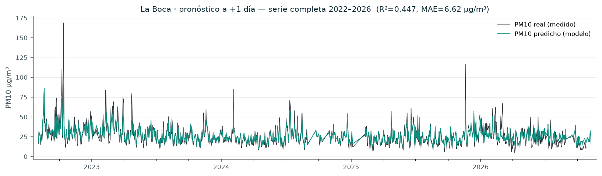
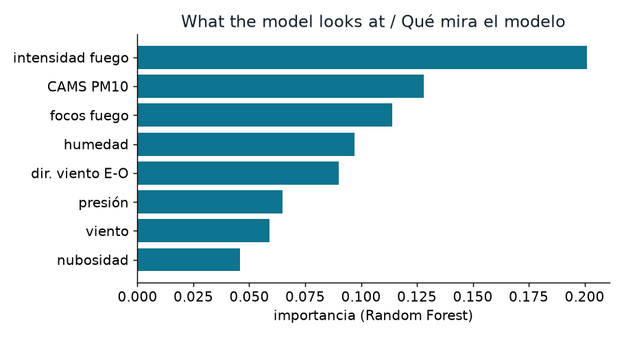
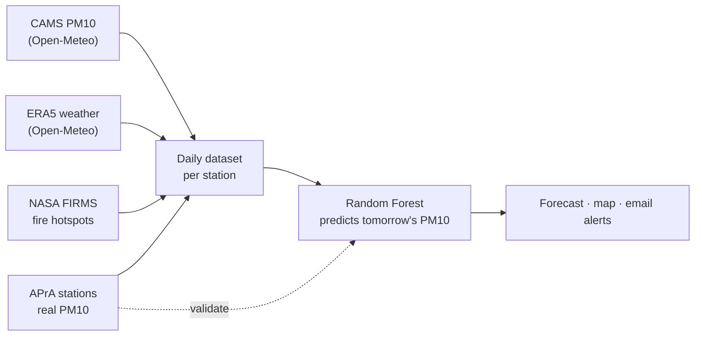
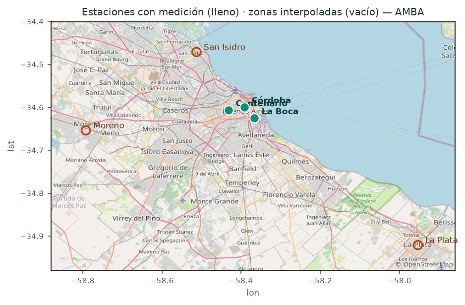
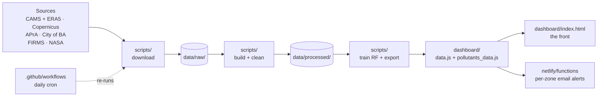
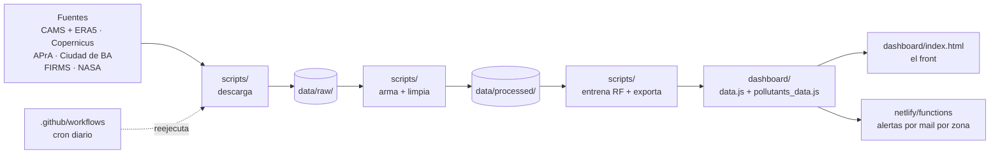

# AireAbierto

**Forecasting next-day PM10 across Buenos Aires with open data only — no paid APIs, no private sensors.**



> 🇬🇧 English first · 🇦🇷 Español más abajo ([saltar al español](#español))

**🌎 Live site / Sitio en vivo → https://calidadaire-amba.netlify.app**

*A group project · UADE — Tecnología y Medio Ambiente · 2C 2026.*
*Team: Franco Massi, Esteban Salman, Lucas Leiva, Ignacio Castro and Joaquín Gallea.*

---

## The question we started with

Buenos Aires has around fifteen million people in its metropolitan area (AMBA) and, for most of this project's history, **three** official air-quality stations in the whole city. If you don't live next to one of them, you simply don't know what you're breathing — and even if you do, the official numbers come out days later.

So we asked a fairly concrete question:

> **Can we forecast tomorrow's PM10 for a neighbourhood using only free, public data, and do it better than just reading the raw satellite model?**

That's the hypothesis. The bet is that by **fusing** a few open sources — a satellite model, real ground stations, and fire detections — you can turn cheap, approximate data into something actually useful: a next-day forecast and an alert, even where there's no sensor.

PM10 is the pollutant we focus on: breathable particulate matter, the dust that comes from traffic, industry and biomass burning. It's the one the city stations have measured for the longest, which gives us ground truth to train and check against.

## The model, in one paragraph

We train a **Random Forest** that predicts the **PM10 of the next day** at a station, using today's conditions. The important design choice is that the model does **not** need yesterday's measured value from the sensor — it leans on the satellite estimate (CAMS), the weather, and nearby fires. That makes it a bit less accurate than a model that cheats with the sensor, but it can run **live**: today's satellite and weather-forecast data are available right now, so we can actually say something about tomorrow. We run it on the three CABA stations that have real data (La Boca, Centenario, Córdoba) and interpolate to other neighbourhoods.



As you'd expect physically, the things that matter most are the satellite PM10 reading, the humidity, and the fire signal.

## Where the data comes from

Everything here is open and free. The only key you need (NASA FIRMS) is free and arrives by email.

| Source | Where it actually comes from | What it measures | Its role here |
|---|---|---|---|
| **Air Quality (CAMS)** | **CAMS**, the Copernicus Atmosphere Monitoring Service — the EU's atmosphere programme, run by **ECMWF**. We pull it through the free **Open-Meteo** API instead of Copernicus directly, because Open-Meteo is simpler and needs no key. | Modelled PM10 in µg/m³, hourly, near-real-time **plus a multi-day forecast** | The backbone input: full coverage and fresh, but smoothed. We feed today's/forecast value to the model. |
| **Weather (ERA5)** | **ERA5**, the reanalysis (and forecast) also produced by **ECMWF / Copernicus**, likewise served via **Open-Meteo**. | Temperature, humidity, rain, wind speed & direction, pressure, cloud cover | Explains how pollution builds up or disperses (wind, rain, mixing). |
| **APrA stations** | **APrA** — Agencia de Protección Ambiental of the **City of Buenos Aires government** — which runs the physical monitoring stations and publishes the readings as open data on the **Buenos Aires Data** portal. | **Real measured** PM10 at the city stations since 2009 | The ground truth. It's what we try to predict and what we validate against. |
| **NASA FIRMS** | **NASA FIRMS** (Fire Information for Resource Management System), with hotspots detected by the **VIIRS and MODIS** instruments aboard NASA satellites. | Fire hotspots (lat, lon, radiative power), near-real-time (~3 h) | The smoke signal. Delta burning season spikes PM10, and the satellite model under-reads it. |

So there are really three providers behind it: **ECMWF / Copernicus** (the European programme) for the satellite air-quality and weather, the **Buenos Aires city government** for the ground sensors, and **NASA** for the fires. Nothing is scraped or private — it's all public data these institutions publish on purpose.

### Columns, per source (raw)

- **CAMS (air quality):** hourly `time`, `pm10` (µg/m³). The API also serves PM2.5, NO₂, CO, O₃, etc., but we only keep **PM10** — the rest added noise for this task.
- **ERA5 (weather):** hourly `time`, `temperature_2m`, `relative_humidity_2m`, `precipitation`, `wind_speed_10m`, `wind_direction_10m`, `surface_pressure`, `cloud_cover`.
- **APrA stations (CSV):** `FECHA`, `HORA`, and one measured column per station (`PM10_LA_BOCA`, `PM10_CENTENARIO`, `PM10_CORDOBA`, …). Values come in µg/m³ as a 24-h moving average; some cells are `s/d` (no data) or `<LD` (below the detection limit).
- **FIRMS (CSV):** per hotspot — `latitude`, `longitude`, `acq_date`, `acq_time`, `frp` (fire radiative power), `satellite`.

## From four sources to one dataset

Raw data is messy and lives on different clocks, so most of the work is here.

**Cleaning.** Station readings that say `<LD` are taken as half the detection limit; `s/d` becomes missing; decimal commas are fixed; repeated hours are averaged. Rows without a real PM10 target are dropped (you can't learn from a label that isn't there).

**Aligning and aggregating.** We build one hourly timeline per station, attach the real measurement by hour and the daily fire totals by day, and then collapse everything to **daily** values. Averages for most variables, a sum for rain, and fire counts within **150 km** of the city (great-circle distance).

**Feature engineering — the parts that aren't obvious:**
- **Wind direction** is turned into a vector (`sin`/`cos` of the bearing) so that 359° and 1° are close, not opposite.
- **Season** is encoded as the cosine of the day of the year; **day of week** captures the weekly traffic rhythm.
- **Fire** becomes two features: how many hotspots nearby (`focos`) and how intense (`frp`).

**Feature selection.** We started with more columns and removed what didn't help, using a drop-one test (take a feature out, see if the score moves). Dew point, wind gusts, the CAMS readings of other pollutants, yesterday's satellite value and the day-of-year sine all turned out to be dead weight, so they're gone.

**The final dataset** (one row per station per day):

```
date · pm10_real (target, next day) · cams (CAMS PM10) ·
temp · rh · prec · wind · wdir_sin · wdir_cos · pres · cloud ·
focos · frp · dow · doy_cos
```



## How the Random Forest actually predicts

The target is **tomorrow's** PM10, so for each day we pair *today's* features with *tomorrow's* measured value. We sort by date and split **80 / 20 in time**: the model learns on the older 80% and is tested on the most recent 20%, which it has never seen. That's the honest way to measure a forecast — you're always predicting the future, never interpolating inside data you already know.

The baseline we compare against is the **raw CAMS value** (just trusting the satellite directly). If the forest can't beat that, it isn't adding anything.

For the **live** forecast, the model takes today's CAMS, the weather forecast and today's fires, and outputs tomorrow's number per station. Other neighbourhoods are filled in by inverse-distance interpolation from the three stations.

## Results — did the hypothesis hold?

Short answer: **yes for PM10, with honest limits.**

| Station | R² (out of sample) | MAE (µg/m³) | Raw CAMS baseline |
|---|---|---|---|
| **La Boca** | 0.45 | 6.6 | ~15 (R² < 0) |
| **Centenario** | 0.41 | 5.2 | ~11 |
| **Córdoba** | 0.29 | 5.3 | ~17 |

The model clearly beats raw CAMS: it roughly halves the error. That's the heart of the whole idea — by putting a few open sources together, a raw estimate that's useless on its own turns into a forecast you can actually use.

It might seem odd for the model to beat CAMS when CAMS is one of its inputs. The thing is, it doesn't copy CAMS, it corrects it. While it trains, the right answer is always the station's real measurement, never the CAMS value, so CAMS goes in as just one more variable and the model learns how much — and under what conditions — CAMS drifts away from reality, leaning on things CAMS can't see like humidity, wind and fire. It's a bit like a scale that always reads a few kilos high: on its own it lies to you, but check it against a good scale for a while and you learn how much to subtract. CAMS is the off scale, the APrA sensors are the reference we only get to use while learning, and the Random Forest is that correction. It never beats the real measurement, but beating raw CAMS is easy, because raw CAMS is biased and smoothed out.

To measure any of this without fooling ourselves we use what machine learning calls a *holdout*: setting aside data the model never sees while training and keeping it only to grade the model. We did that two ways. The *temporal holdout* hides the most recent dates — train on the older 80%, test on the recent 20% — which tells us whether it can actually forecast the next day; those are the per-station numbers in the table. The harder one is the *spatial holdout* (a *leave-one-station-out*): we hide a whole station, train on two and cover the third as if it had no sensor, let the model estimate it from satellite, weather and fire alone, and only afterwards compare against what that sensor had really recorded — once for each station.

That second test is the one that counts for the map and the per-zone alerts, since that's exactly where we promise a number with no sensor underneath. Averaged over the three hidden stations the error is 5.2 µg/m³ (R² 0.52). Raw CAMS on its own lands at a negative R² (somewhere between −1.2 and −2.6) — day to day, trusting it directly is worse than just always guessing the long-run average. So "better than the satellite" isn't our impression; it's what the data we held back actually shows.

Here are both exams side by side, per station:

| Station | Temporal (forecast tomorrow) | Spatial (fill in, no sensor) |
|---|---|---|
| La Boca | R² 0.45 · MAE 6.6 | R² 0.48 · MAE 5.6 |
| Centenario | R² 0.41 · MAE 5.2 | R² 0.46 · MAE 5.7 |
| Córdoba | R² 0.29 · MAE 5.3 | R² 0.63 · MAE 4.0 |
| **Global (spatial)** | — | **R² 0.52 · MAE 5.2** |

The two don't compare one-to-one, because they ask different things: the temporal exam forecasts the *future* (harder — tomorrow hasn't happened yet), while the spatial one fills in the *present* at a station with no sensor (easier, since the three city stations sit close together and move in step). That's also why Córdoba is the hardest to forecast yet the easiest to fill in. The **Global** figure is simply those three spatial results combined — that's where the 5.2 µg/m³ / R² 0.52 comes from.



**Where we're honest about the limits:**
- We tried NO₂ and CO too. Without the sensor, they fell apart (negative R²), so we **dropped them** and kept only PM10. Claiming a forecast there would have been dishonest.
- With only three stations, all inside the city, the interpolation to far-out zones (San Isidro, Moreno, La Plata) is extrapolation — it won't capture real local differences. More stations is the fix, not a fancier model.
- The model **ranks bad days well but understates how bad they get**. A Random Forest smooths extremes, so on a high day it predicts an elevated value that still falls short of the real peak (it reads ~33 when the truth is ~42). The prediction and reality correlate well (r ≈ 0.71), so it knows *which* days are bad — it just lowballs the number. That matters for the alert: if you trigger at the real health limit (50) on a prediction that always runs ~10 low, it almost never fires. So we **lowered the alert thresholds by about 10** (Caution at a predicted 30, Alert at 40) to undo that bias. With that correction the warning catches **7 of 7 days that really exceeded 50**, and about **three quarters of the days above 40** — at the cost of some false alarms, which for a health warning is the right trade (better to over-warn than miss bad air). What it still can't do is tell you the exact peak number. And the raw satellite can't even do the ranking — its next-day value never got past 38, so at any sane threshold it would miss every single high day.

So the hypothesis holds for what it can honestly support: **next-day PM10, forecast from free data, better than the raw satellite, and usable where no sensor exists.**

## Project layout — from data to front

The repo is really one pipeline: raw data comes in on the left, a static dashboard comes out on the right, and each folder is one stage of that trip.

| Folder | What it does in the pipeline |
|---|---|
| `data/raw/` | Exactly what the sources return, untouched — CAMS + ERA5 (via Open-Meteo), the APrA station CSVs, and the FIRMS fire hotspots. |
| `data/processed/` | The cleaned, daily, per-station datasets the model actually reads, plus the ICA (air-quality index). This is what the download-and-clean step produces. |
| `scripts/` | The whole pipeline as small Python steps: download the sources, build the daily dataset, train the Random Forest, and write the two data files the front reads. `update_daily.py` chains them in order; `alerta_mail.py` sends the warnings. |
| `dashboard/` | The front itself — a single static `index.html` that reads `pollutants_data.js` (the model's forecast per station) and `data.js` (metrics, ICA, the holdout note). No build step and no server needed just to look at it. |
| `netlify/functions/` | Two serverless endpoints for the live site: `suscribir` (sign-up + welcome email) and `alerta-diaria` (the scheduled daily check that emails whoever's zone is about to be high). |
| `.github/workflows/` | The daily cron: it re-runs the pipeline once a day and commits the refreshed `data.js` / `pollutants_data.js`, which makes Netlify redeploy on its own. |
| `docs/` | The images used in this README. |



## Running it locally

```bash
python scripts/servidor.py      # local panel at http://localhost:8777
```

`scripts/update_daily.py` runs the whole cycle in one go (download → clean → retrain → alerts). To make the emails and the fire data work, you bring your own credentials: set up your own SMTP access (a Gmail app password, for example) and get your own free NASA FIRMS key. Those live as environment variables in a local `.env` file that never gets committed — `MAIL_HOST`, `MAIL_PORT`, `MAIL_USER`, `MAIL_PASS` and `FIRMS_MAP_KEY`.

## Deploy

The live version runs on free tiers: **Netlify** serves the dashboard and the two email functions (sign-up/welcome and the daily report), and a **GitHub Actions** job refreshes the data once a day and pushes it, so Netlify redeploys on its own. Secrets never live in the repo — the SMTP login goes in Netlify's environment variables and the FIRMS key in a GitHub Actions secret. Subscribers' emails are kept privately in Netlify Blobs, never in the repo.

---
<a name="español"></a>
# AireAbierto (Español)

**Pronóstico del PM10 del día siguiente en el AMBA usando solo datos abiertos — sin APIs pagas ni sensores privados.**

**🌎 Sitio en vivo → https://calidadaire-amba.netlify.app**

*Proyecto grupal · UADE — Tecnología y Medio Ambiente · 2C 2026.*
*Equipo: Franco Massi, Esteban Salman, Lucas Leiva, Ignacio Castro y Joaquín Gallea.*


## La pregunta del principio

El AMBA tiene unos quince millones de habitantes y, durante casi todo el proyecto, **tres** estaciones oficiales de calidad del aire en toda la ciudad. Si no vivís al lado de una, no sabés qué respirás — y aunque vivas cerca, el dato oficial sale varios días después.

Así que arrancamos con una pregunta bien concreta:

> **¿Podemos pronosticar el PM10 de mañana para un barrio usando solo datos públicos y gratuitos, y hacerlo mejor que leer el modelo satelital crudo?**

Esa es la hipótesis. La apuesta es que **fusionando** unas pocas fuentes abiertas — un modelo satelital, estaciones reales y detección de incendios — se puede convertir un dato barato y aproximado en algo realmente útil: un pronóstico a un día y una alerta, incluso donde no hay sensor.

El contaminante en el que nos enfocamos es el **PM10**: material particulado respirable, el polvo que viene del tránsito, la industria y la quema de biomasa. Es el que las estaciones de la ciudad miden hace más tiempo, y eso nos da con qué entrenar y contra qué chequear.

## El modelo, en un párrafo

Entrenamos un **Random Forest** que predice el **PM10 del día siguiente** en una estación, a partir de las condiciones de hoy. La decisión de diseño importante es que el modelo **no** necesita el valor medido de ayer del sensor: se apoya en la estimación satelital (CAMS), la meteorología y los incendios cercanos. Eso lo hace algo menos preciso que un modelo que "hace trampa" con el sensor, pero le permite correr **en vivo**: los datos satelitales y el pronóstico del tiempo de hoy ya están disponibles, así que podemos decir algo sobre mañana. Lo corremos en las tres estaciones de CABA con dato real (La Boca, Centenario, Córdoba) e interpolamos a otros barrios.


Como era de esperar físicamente, lo que más pesa es la lectura satelital de PM10, la humedad y la señal de fuego.

## De dónde vienen los datos

Todo es abierto y gratis. La única clave que hace falta (NASA FIRMS) es gratuita y llega por email.

| Fuente | De dónde viene en realidad | Qué mide | Su rol acá |
|---|---|---|---|
| **Calidad de aire (CAMS)** | **CAMS**, el Servicio de Monitoreo de la Atmósfera de **Copernicus** — el programa de atmósfera de la Unión Europea, operado por el **ECMWF**. Lo bajamos por la API gratuita de **Open-Meteo** en vez de ir directo a Copernicus, porque Open-Meteo es más simple y no pide clave. | PM10 modelado en µg/m³, horario, casi en tiempo real **más pronóstico de varios días** | El insumo central: cobertura total y fresco, pero suavizado. Al modelo le damos el valor de hoy/pronóstico. |
| **Meteorología (ERA5)** | **ERA5**, el reanálisis (y pronóstico) también del **ECMWF / Copernicus**, servido igual por **Open-Meteo**. | Temperatura, humedad, lluvia, viento (velocidad y dirección), presión, nubosidad | Explica cómo se acumula o se dispersa la contaminación (viento, lluvia, mezcla). |
| **Estaciones APrA** | **APrA** — la Agencia de Protección Ambiental del **Gobierno de la Ciudad de Buenos Aires** — que opera las estaciones físicas de monitoreo y publica las mediciones como dato abierto en el portal **Buenos Aires Data**. | PM10 **medido real** en las estaciones de la ciudad desde 2009 | La verdad de campo. Es lo que intentamos predecir y contra lo que validamos. |
| **NASA FIRMS** | **NASA FIRMS** (Fire Information for Resource Management System), con focos detectados por los instrumentos **VIIRS y MODIS** a bordo de satélites de la NASA. | Focos de incendio (lat, lon, potencia radiativa), casi en tiempo real (~3 h) | La señal del humo. La quema del Delta dispara el PM10, y el modelo satelital lo subestima. |

O sea que detrás hay tres proveedores: el **ECMWF / Copernicus** (el programa europeo) para el satélite de calidad de aire y la meteorología, el **Gobierno de la Ciudad de Buenos Aires** para los sensores de piso, y la **NASA** para los incendios. Nada se scrapea ni es privado — es todo dato público que estas instituciones publican a propósito.

### Columnas, por fuente (crudo)

- **CAMS (calidad de aire):** `time` horario, `pm10` (µg/m³). La API también sirve PM2,5, NO₂, CO, O₃, etc., pero nos quedamos **solo con PM10** — el resto agregaba ruido para esta tarea.
- **ERA5 (meteo):** `time` horario, `temperature_2m`, `relative_humidity_2m`, `precipitation`, `wind_speed_10m`, `wind_direction_10m`, `surface_pressure`, `cloud_cover`.
- **Estaciones APrA (CSV):** `FECHA`, `HORA`, y una columna medida por estación (`PM10_LA_BOCA`, `PM10_CENTENARIO`, `PM10_CORDOBA`, …). Vienen en µg/m³ como promedio móvil de 24 h; algunas celdas son `s/d` (sin dato) o `<LD` (bajo el límite de detección).
- **FIRMS (CSV):** por foco — `latitude`, `longitude`, `acq_date`, `acq_time`, `frp` (potencia radiativa del fuego), `satellite`.

## De cuatro fuentes a un solo dataset

El dato crudo es desprolijo y vive en relojes distintos, así que la mayor parte del trabajo está acá.

**Limpieza.** Las lecturas que dicen `<LD` se toman como la mitad del límite de detección; `s/d` pasa a nulo; se arreglan las comas decimales; las horas repetidas se promedian. Las filas sin PM10 real (sin objetivo) se descartan: no se puede aprender de una etiqueta que no está.

**Alineación y agregación.** Armamos una línea de tiempo horaria por estación, le pegamos la medición real por hora y los totales de fuego por día, y después colapsamos todo a valores **diarios**. Promedio para casi todo, suma para la lluvia, y conteo de focos a menos de **150 km** de la ciudad (distancia sobre la esfera).

**Feature engineering — lo que no es obvio:**
- La **dirección del viento** se convierte en vector (`sin`/`cos` del rumbo) para que 359° y 1° estén cerca, no opuestos.
- La **estación del año** se codifica como el coseno del día del año; el **día de la semana** captura el ritmo semanal del tránsito.
- El **fuego** se vuelve dos variables: cuántos focos cerca (`focos`) y qué tan intensos (`frp`).

**Selección de variables.** Empezamos con más columnas y sacamos lo que no aportaba, con un test *drop-one* (sacás una variable y mirás si cambia el puntaje). El punto de rocío, las ráfagas, las lecturas CAMS de otros contaminantes, el valor satelital de ayer y el seno del día del año resultaron ser peso muerto, así que no están.

**El dataset final** (una fila por estación por día):

```
date · pm10_real (objetivo, día siguiente) · cams (CAMS PM10) ·
temp · rh · prec · wind · wdir_sin · wdir_cos · pres · cloud ·
focos · frp · dow · doy_cos
```

## Cómo predice el Random Forest

El objetivo es el PM10 de **mañana**, así que por cada día emparejamos las variables de *hoy* con el valor medido de *mañana*. Ordenamos por fecha y partimos **80 / 20 en el tiempo**: el modelo aprende con el 80% más viejo y se evalúa con el 20% más reciente, que nunca vio. Esa es la forma honesta de medir un pronóstico — siempre predecís el futuro, nunca interpolás dentro de datos que ya conocés.

El baseline contra el que comparamos es el **valor CAMS crudo** (confiar directo en el satélite). Si el bosque no le gana a eso, no está aportando nada.

Para el pronóstico **en vivo**, el modelo toma el CAMS de hoy, el pronóstico del tiempo y los incendios de hoy, y devuelve el número de mañana por estación. Los otros barrios se completan por interpolación de distancia inversa desde las tres estaciones.

## Resultados — ¿se validó la hipótesis?

Respuesta corta: **sí para el PM10, con límites honestos.**

| Estación | R² (fuera de muestra) | MAE (µg/m³) | Baseline CAMS crudo |
|---|---|---|---|
| **La Boca** | 0,45 | 6,6 | ~15 (R² < 0) |
| **Centenario** | 0,41 | 5,2 | ~11 |
| **Córdoba** | 0,29 | 5,3 | ~17 |

El modelo le gana claro al satélite crudo: le baja el error más o menos a la mitad. Eso es el centro de la idea — juntando unas pocas fuentes abiertas, una estimación cruda que sola no sirve se vuelve un pronóstico que sí se puede usar.

Puede sonar raro que le gane a CAMS si justamente se entrena con CAMS. Lo que pasa es que no lo copia, lo corrige. Mientras entrena, la respuesta correcta es siempre la medición real de la estación, nunca el valor de CAMS; entonces CAMS entra como una variable más y el modelo va aprendiendo cuánto —y en qué condiciones— se despega de la realidad, apoyándose en cosas que CAMS no ve, como la humedad, el viento y el fuego. Es parecido a una balanza que siempre marca unos kilos de más: sola te miente, pero si la comparás un tiempo contra una balanza buena aprendés cuánto restarle. CAMS es la balanza desviada, los sensores de APrA son la referencia que solo usamos para aprender, y el Random Forest es esa corrección. A la medición real nunca le gana, pero a CAMS crudo le gana fácil, porque CAMS crudo viene sesgado y suavizado.

Para medir todo esto sin hacernos trampa usamos lo que en machine learning se llama un *holdout*: apartar datos que el modelo no ve mientras entrena y guardarlos solo para evaluarlo. Lo hicimos de dos maneras. El *holdout temporal* esconde las fechas más nuevas —entrenamos con el 80% más viejo y probamos con el 20% reciente—, y es lo que nos dice si de verdad sabe pronosticar el día siguiente; esos son los números por estación de la tabla. El otro, más duro, es el *holdout espacial* (un *leave-one-station-out*): escondemos una estación entera, entrenamos con dos y tapamos la tercera como si no tuviera sensor, dejamos que la estime solo con satélite, meteo y fuego, y recién ahí comparamos contra lo que ese sensor había medido en realidad — una vez por cada estación.

Esa segunda prueba es la que importa para el mapa y las alertas por zona, porque es justo donde prometemos un número sin un sensor abajo. Promediando las tres estaciones ocultas el error queda en 5,2 µg/m³ (R² 0,52). El satélite solo, en cambio, cae en un R² negativo (entre −1,2 y −2,6): día a día, confiar directo en él es peor que tirar siempre el promedio histórico. Por eso lo de "mejor que el satélite" no es una impresión nuestra, es lo que muestran los datos que dejamos afuera.

Acá están las dos pruebas lado a lado, por estación:

| Estación | Temporal (predecir mañana) | Espacial (estimar sin sensor) |
|---|---|---|
| La Boca | R² 0,45 · MAE 6,6 | R² 0,48 · MAE 5,6 |
| Centenario | R² 0,41 · MAE 5,2 | R² 0,46 · MAE 5,7 |
| Córdoba | R² 0,29 · MAE 5,3 | R² 0,63 · MAE 4,0 |
| **Global (espacial)** | — | **R² 0,52 · MAE 5,2** |

Las dos no se comparan uno a uno, porque preguntan cosas distintas: la prueba temporal pronostica el *futuro* (más difícil — mañana todavía no pasó), y la espacial rellena el *presente* en una estación sin sensor (más fácil, porque las tres estaciones de la ciudad están cerca y se mueven juntas). Por eso Córdoba es la más difícil de pronosticar pero la más fácil de rellenar. El valor **Global** es, simplemente, esas tres pruebas espaciales combinadas — de ahí sale el 5,2 µg/m³ / R² 0,52.


**Dónde somos honestos con los límites:**
- Probamos también NO₂ y CO. Sin el sensor, se derrumbaban (R² negativo), así que los **sacamos** y nos quedamos solo con PM10. Afirmar un pronóstico ahí habría sido deshonesto.
- Con solo tres estaciones, todas dentro de la ciudad, interpolar a zonas lejanas (San Isidro, Moreno, La Plata) es extrapolar — no captura las diferencias locales reales. La solución es más estaciones, no un modelo más complejo.
- El modelo **ordena bien los días malos pero subestima cuánto llegan**. Un Random Forest suaviza los extremos, así que en un día alto predice un valor elevado pero que se queda corto del pico real (lee ~33 cuando la verdad es ~42). La predicción y la realidad correlacionan bien (r ≈ 0,71): sabe *qué* días son malos, solo que tira el número bajo. Eso importa para la alerta: si disparás en el límite de salud (50) sobre una predicción que siempre queda ~10 corta, casi nunca salta. Por eso **bajamos los umbrales de aviso unos 10** (Precaución con una predicción de 30, Alerta con 40) para compensar ese sesgo. Con esa corrección el aviso capta **7 de 7 días que de verdad superaron 50** y alrededor de **tres cuartos de los días por encima de 40** — a costa de alguna falsa alarma, que para un aviso de salud es el canje correcto (mejor avisar de más que dejar pasar aire malo). Lo que sigue sin poder hacer es decirte el valor exacto del pico. Y el satélite crudo no puede ni siquiera ordenar los días: su valor de mañana nunca pasó de 38, así que con cualquier umbral razonable se perdería todos los días altos.

Entonces la hipótesis se sostiene para lo que puede sostener con honestidad: **PM10 del día siguiente, pronosticado con datos gratuitos, mejor que el satélite crudo, y usable donde no hay sensor.**

## Estructura del proyecto — de los datos al front

El repo es, en el fondo, un solo pipeline: los datos crudos entran por la izquierda, sale un dashboard estático por la derecha, y cada carpeta es una etapa de ese camino.

| Carpeta | Qué hace en el pipeline |
|---|---|
| `data/raw/` | Lo que devuelven las fuentes, sin tocar — CAMS + ERA5 (vía Open-Meteo), los CSV de las estaciones APrA y los focos de fuego de FIRMS. |
| `data/processed/` | Los datasets ya limpios, diarios y por estación que el modelo realmente lee, más el ICA (índice de calidad del aire). Es lo que produce el paso de descarga-y-limpieza. |
| `scripts/` | Todo el pipeline en pasos chicos de Python: descargar las fuentes, armar el dataset diario, entrenar el Random Forest y escribir los dos archivos de datos que lee el front. `update_daily.py` los encadena en orden; `alerta_mail.py` manda los avisos. |
| `dashboard/` | El front en sí — un único `index.html` estático que lee `pollutants_data.js` (el pronóstico del modelo por estación) y `data.js` (métricas, ICA, la nota del holdout). Sin paso de build y sin servidor solo para mirarlo. |
| `netlify/functions/` | Dos endpoints serverless para el sitio en vivo: `suscribir` (alta + mail de bienvenida) y `alerta-diaria` (el chequeo diario programado que le manda mail a quien tenga su zona por ponerse alta). |
| `.github/workflows/` | El cron diario: vuelve a correr el pipeline una vez por día y commitea los `data.js` / `pollutants_data.js` frescos, lo que hace que Netlify redeployee solo. |
| `docs/` | Las imágenes que usa este README. |



## Cómo correrlo en local

```bash
python scripts/servidor.py      # panel local en http://localhost:8777
```

`scripts/update_daily.py` hace todo el ciclo de una (descarga → limpia → reentrena → alertas). Para que anden los correos y los datos de fuego, ponés vos tus credenciales: configurás tu propio acceso SMTP (por ejemplo, una clave de aplicación de Gmail) y conseguís tu propia clave gratuita de NASA FIRMS. Eso vive como variables de entorno en un archivo `.env` local que nunca se sube al repo — `MAIL_HOST`, `MAIL_PORT`, `MAIL_USER`, `MAIL_PASS` y `FIRMS_MAP_KEY`.

## Deploy

La versión en vivo corre en planes gratuitos: **Netlify** sirve el dashboard y las dos funciones de correo (alta/bienvenida y el parte diario), y un job de **GitHub Actions** refresca los datos una vez por día y los pushea, así Netlify redeploya solo. Los secretos nunca viven en el repo — el login SMTP va en las variables de entorno de Netlify y la clave de FIRMS en un secret de GitHub Actions. Los correos de los suscriptos se guardan de forma privada en Netlify Blobs, nunca en el repo.
